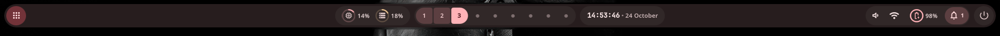
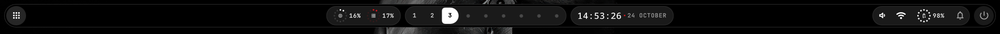
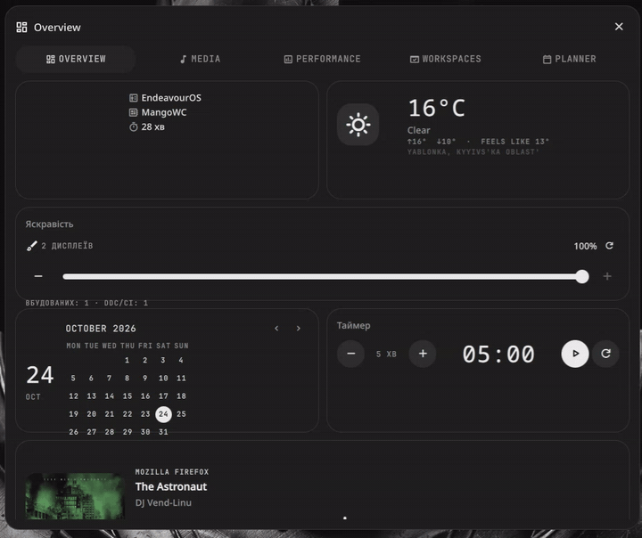
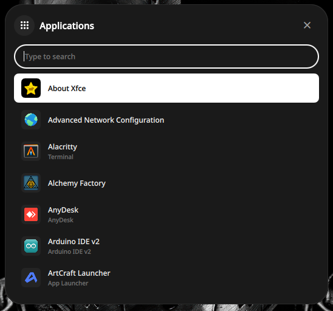
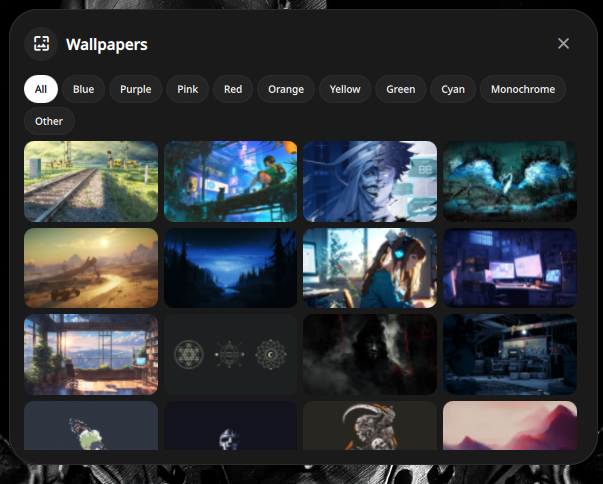
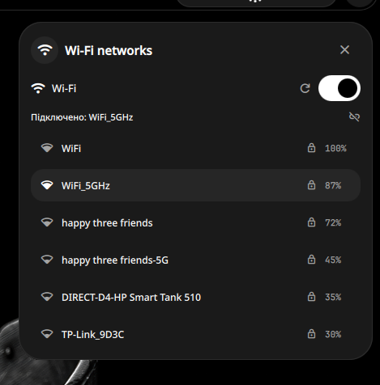
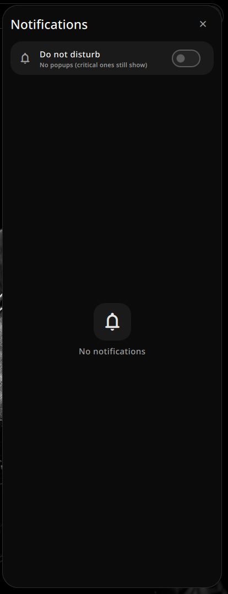
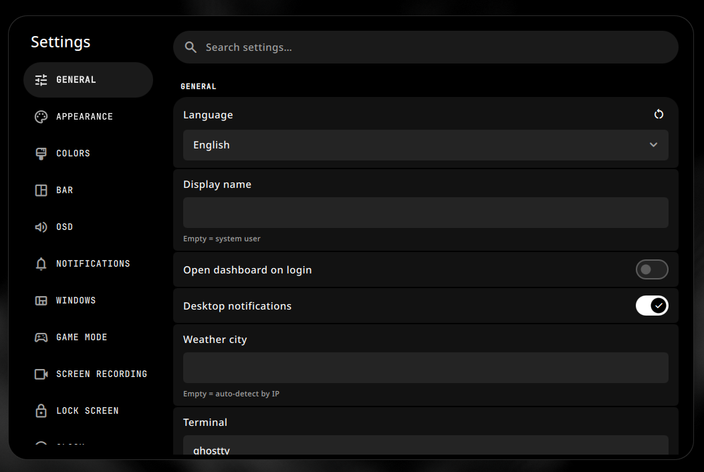

<div align="center">

# Edots

**A minimal, functional rice for [MangoWM](https://github.com/DreamMaoMao/mangowc) + [Quickshell](https://quickshell.org)**
Two interchangeable designs — **Material 3 Expressive** and **Nothing** — one palette generated from your wallpaper.


[Features](#-features) · [Gallery](#-gallery) · [Installation](#-installation) · [Keybinds](#-keybinds) · [IPC](#-ipc) · [Colors](#-color-system) · [Structure](#-structure)

<br>


<sub><b>Material 3</b> — tonal pills, dynamic colors from the wallpaper</sub>

<br><br>


<sub><b>Nothing</b> — monochrome, dot-matrix rings, one red accent</sub>

</div>

<br>

## ✨ Features

|  |  |
|---|---|
| 🎨 **Two designs** | Material 3 Expressive and Nothing, light and dark. Switch live in *Settings → Appearance* or with `ipc call theme toggleDesign`. Animated transitions: `fade`, `dots`, `scan` or off. |
| 🧩 **Modular bar** | Per-monitor bar on any edge (top / bottom / left / right). Launcher, active window, media player, resources, workspaces, clock, volume, network, battery, notifications, power. Modules can be toggled from Settings. |
| 🪄 **Surfaces** | Launcher, wallpapers, clipboard, mixer, Wi-Fi, media, power menu, keybind cheat-sheet and resources open as floating cards next to the bar — on the monitor you are using. |
| 🖼 **Wallpapers by color** | The picker sorts your wallpapers into Blue / Purple / Pink / Red / Orange / Yellow / Green / Cyan / Monochrome. Files are never touched; the index lives in `~/.cache/quickshell`. |
| 📊 **Dashboard** | Overview, Media, Performance, Workspaces and Planner tabs. Weather (Open-Meteo, no API key), CPU / RAM / disk, brightness, volume, calendar with timed tasks. |
| 🔔 **Own notification daemon** | Popups, a notification center and Do Not Disturb. The bar bell expands into a live pill for new notifications. `swaync` is not required. |
| 🔊 **OSD** | Volume and brightness overlays on the active monitor. |
| ⚙️ **Settings app** | A separate window with live controls, search across every option and a ↺ reset on each control. Persisted to `~/.config/quickshell/*.json`. |
| 🔒 **Lock screen** | Quickshell + PAM lock screen: ken burns, parallax, floating shapes, power buttons. Lock-then-suspend through logind. |
| 🎮 **Game mode** | One switch turns off blur, animations and effects; the bar shows a pill while it is active. |
| 🎥 **Screen tools** | Screenshot / OCR / recording overlay (QuickSnip) with a recording indicator in the bar. |
| 🌍 **Languages** | English and Ukrainian UI. |

<br>

## 🖼 Gallery

### Dashboard

<div align="center">
  
  <br>
  <sub>Press <kbd>Super</kbd>+<kbd>D</kbd> · <a href="screenshots/Dashboard.mp4">watch the full video (MP4)</a></sub>
</div>

<br>

### Launcher & wallpapers

<table>
  <tr>
    <td width="50%" valign="top" align="center">
      
      <br><b>Launcher</b>
      <br><sub><kbd>Super</kbd>+<kbd>Space</kbd> — fuzzy search over desktop entries, icons and categories</sub>
    </td>
    <td width="50%" valign="top" align="center">
      
      <br><b>Wallpaper selector</b>
      <br><sub><kbd>Super</kbd>+<kbd>C</kbd> — filter by dominant color; picking one recolors the whole system</sub>
    </td>
  </tr>
</table>

<br>

### Network & notifications

<table>
  <tr>
    <td width="60%" valign="top" align="center">
      
      <br><b>Wi-Fi</b>
      <br><sub><kbd>Super</kbd>+<kbd>W</kbd> — connect, disconnect, signal strength and security at a glance</sub>
    </td>
    <td width="40%" valign="top" align="center">
      
      <br><b>Notification center</b>
      <br><sub>History, Do Not Disturb, critical ones always get through</sub>
    </td>
  </tr>
</table>

<br>

### Settings

<div align="center">
  
  <br>
  <sub><kbd>Super</kbd>+<kbd>A</kbd> — General · Appearance · Colors · Bar · OSD · Notifications · Windows · Game mode · Screen recording · Lock screen · Clock</sub>
</div>

<br>

## 📦 Requirements

- **[Quickshell](https://quickshell.org)** with Io / Wayland / Services / Networking / UPower / Pipewire / Mpris
- **[MangoWM](https://github.com/DreamMaoMao/mangowc)** (`mangowc-git`) — uses the JSON `mmsg` IPC (`get` / `watch` / `dispatch`)
- **Fonts:** `SF Pro Display` (optional, proprietary), `SF Mono`, `JetBrainsMono Nerd Font`, `Material Symbols Rounded`, `Google Sans Flex`
- **Tools:** `matugen`, `awww`, `cliphist`, `brightnessctl`, `nmcli`, `rfkill`, `playerctl`, `grim`, `tesseract`, `python3`, `python-pillow`, `jq`
- **Lock screen:** `gcc` and PAM headers (`pam-auth` is built by `install.sh`)

<br>

## 🚀 Installation

```sh
git clone https://github.com/Edgit13/Edots-rice ~/Dotfiles
cd ~/Dotfiles && ./install.sh
# log out and back in so fish / swayidle / systemd pick up the environment
```

What `install.sh` does:

1. Clones the repo and `Edot-Wallpapers` (into `~/Pictures/Wallpapers`).
2. Installs packages from pacman and the AUR (`yay` is bootstrapped automatically).
3. Installs Google Sans Flex.
4. Runs `./sync.sh install` to symlink configs into `~/.config`.
5. Registers and starts the systemd user services (`swayidle`, `edots-lockscreen`).
6. Builds `lockscreen/pam-auth`.
7. Generates the first palette from the first wallpaper.

Start the shell manually:

```sh
qs -p ~/.config/quickshell/bar/shell.qml
```

`install.sh --auto` runs without prompts (NixOS bootstrap and unattended Arch).

### Wallpaper color index

The color filter in the wallpaper selector needs a one-time scan (and a rescan after adding wallpapers):
open **Settings → Wallpapers → Analyze wallpapers**. It runs `scripts/wallpaper_color_index.py`
and writes `~/.cache/quickshell/wallpaper-colors.json`. Your image files are not modified.

<br>

## ⌨️ Keybinds

Defined in `mango/binds.conf`.

| Bind | Action |
|---|---|
| <kbd>Super</kbd>+<kbd>Space</kbd> | Launcher |
| <kbd>Super</kbd>+<kbd>C</kbd> | Wallpapers |
| <kbd>Super</kbd>+<kbd>V</kbd> | Clipboard history |
| <kbd>Super</kbd>+<kbd>W</kbd> | Wi-Fi |
| <kbd>Super</kbd>+<kbd>X</kbd> | Mixer |
| <kbd>Super</kbd>+<kbd>O</kbd> | Power menu |
| <kbd>Super</kbd>+<kbd>A</kbd> | Settings |
| <kbd>Super</kbd>+<kbd>D</kbd> | Dashboard |
| <kbd>Super</kbd>+<kbd>T</kbd> | Task manager |
| <kbd>Super</kbd>+<kbd>U</kbd> | QuickSnip (screen capture / recording) |
| <kbd>Super</kbd>+<kbd>L</kbd> | Lock screen |
| <kbd>Super</kbd>+<kbd>F3</kbd> | Suspend (lock, then suspend) |
| <kbd>Super</kbd>+<kbd>Esc</kbd> | Close the open surface |
| <kbd>Super</kbd>+<kbd>B</kbd> / <kbd>Super</kbd>+<kbd>E</kbd> | Firefox / Files |

Surfaces opened from a keybind appear on the **focused monitor**; clicking a bar module opens it on that bar's monitor.

<br>

## 🔌 IPC

Everything is scriptable through Quickshell IPC:

```sh
alias edots='qs -p ~/.config/quickshell/bar/shell.qml ipc call'

edots pill toggleLauncher        # also: toggleWallpaper, toggleClipboard, toggleMixer,
                                 #       toggleWifi, toggleMedia, togglePower,
                                 #       toggleBinds, toggleResources, close
edots dashboard toggle           # open | toggle | close
edots tasks toggle
edots settingsapp toggle
edots screentool toggle          # open | close | toggle | stop (stops a recording)
edots notifications toggle       # open | close | clear | dnd
edots osd volumeUp               # volumeDown, volumeMute, brightnessUp, brightnessDown
edots theme toggleDesign         # Material <-> Nothing
edots theme setMode dark         # or: light, toggleMode
edots theme setTransition dots   # off | fade | dots | scan
```

<br>

## 🎨 Color system

One palette, many consumers. `wallcolors.py` (matugen plus custom HSL rules) writes:

| File | Consumer |
|---|---|
| `~/.config/quickshell/colors.json` | bar, lock screen, settings |
| `~/.config/quickshell/dock-colors.json` | dock |
| `~/.config/mango/colors.json` | bar (duplicate) |
| `~/.config/mango/swaylock/colors.conf` | swaylock (legacy) |
| `~/.config/{kitty,ghostty}/*-colors.conf` | terminals |
| `~/.config/gtk-{3.0,4.0}/gtk-colors.css` | GTK |
| `~/.config/firefox-colors.css` | Firefox chrome |
| `~/.config/rofi/colors.rasi` | rofi |
| `~/.config/fish/fish-colors.fish` | fish |
| `~/.config/kdeglobals` | Qt / KDE |

Change the wallpaper and **everything** updates live — Quickshell, GTK, kitty and fish repaint without a restart.
The **Nothing** design uses its own fixed monochrome palette and ignores wallpaper colors.

<br>

## 🗂 Structure

```
quickshell/bar/               # the shell
├── shell.qml  ShellNext.qml  # entry points
├── config/                   # defaults and settings backend
├── theme/                    # tokens: colors, typography, motion, shape, Nothing palette
├── shell/                    # BarWindow, MorphSurface, SurfaceOverlay, ShellState
├── modules/                  # bar modules (clock, volume, network, media, …)
│   └── common/               # BarModule, BarButton, BarRingStat, BarRevealButton, BarIcon
├── surfaces/                 # launcher, wallpapers, clipboard, mixer, Wi-Fi, power, …
├── dashboard/                # dashboard tabs and widgets
├── notifications/            # popups + notification center
├── osd/  dock/  screentool/  # overlays, dock, capture & recording
├── lockscreen/               # lock screen, PAM helper, logind hooks
├── services/                 # Mango, Wi-Fi, media, weather, performance, notifications, …
├── settings/                 # settings app (pages, controls, schema, i18n)
├── scripts/                  # gamemode.sh, wallpaper_color_index.py
└── tools/                    # mango-probe.sh

mango/                        # MangoWM config (binds, rules, animations, swayidle, scripts)
edots/                        # CLI tools: task-manager, tui-player, tool-manager (upkg, utimer)
systemd/                      # user units: swayidle, edots-lockscreen
fish/ ghostty/ kitty/ gtk-3.0/ gtk-4.0/ firefox/ rofi/ nvim/
install.sh  sync.sh           # bootstrap and symlink manager
```

<br>

## ❄️ NixOS

See [nix/README.md](nix/README.md) — modules for NixOS + home-manager (mango flake, quickshell, capture stack).

## 📄 License

MIT
